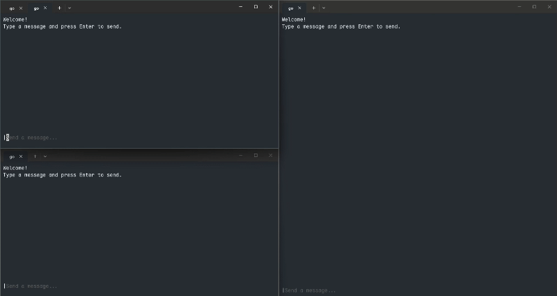

# Broadcast Server with Bubble Tea

A lightweight real-time message broadcasting application built with Go. It allows multiple clients to connect to a WebSocket server, send messages, and receive broadcasts from other connected clients through an interactive terminal interface.

The project uses **Gorilla WebSocket** for real-time communication and **Bubble Tea** to provide an interactive terminal UI (TUI).



## Features

- **Real-time messaging** – Send and receive messages through WebSocket connections.
- **Message broadcasting** – Messages sent by one client are broadcast to all connected clients.
- **Interactive terminal UI** – Chat through a terminal interface powered by Bubble Tea.
- **Multiple clients** – Multiple users can connect to the same server simultaneously.
- **Username identification** – Messages include the sender's username.
- **CLI commands** – Manage the server and client using Cobra commands.

## Tech Stack

| Technology | Purpose |
|---|---|
| [Go](https://go.dev/) | Main programming language |
| [Gorilla WebSocket](https://github.com/gorilla/websocket) | WebSocket communication between server and clients |
| [Bubble Tea](https://github.com/charmbracelet/bubbletea) | Interactive terminal UI |
| [Bubbles](https://github.com/charmbracelet/bubbles) | Terminal UI components, including textarea and viewport |
| [Lip Gloss](https://github.com/charmbracelet/lipgloss) | Terminal styling |
| [Cobra](https://github.com/spf13/cobra) | CLI commands and flag management |

## Prerequisites

- Go 1.26 or later
- A terminal that supports interactive terminal applications

## Getting Started

### 1. Clone the repository

```bash
git clone https://github.com/Permanaa/broadcast-server-with-bubbletea.git

cd broadcast-server-with-bubbletea
```

### 2. Install dependencies

```bash
go mod download
```

## Usage

The application provides two main commands:

- `start` – Start the WebSocket broadcast server.
- `connect` – Connect a client to the running server.

### Start the Server

Open a terminal and run:

```bash
go run ./cmd/broadcast-server start
```

The server will start listening on port `1804`.

```text
Websocket server started on :1804
```

The WebSocket endpoint is:

```text
ws://localhost:1804/ws
```

### Connect a Client

Open another terminal and run:

```bash
go run ./cmd/broadcast-server connect
```

You can also specify a username:

```bash
go run ./cmd/broadcast-server connect --user alice
```

Or use the shorthand flag:

```bash
go run ./cmd/broadcast-server connect -u alice
```

Once connected, the Bubble Tea terminal interface will appear. Type your message and press `Enter` to broadcast it to other connected clients.

## CLI Commands

### Available Commands

| Command | Description |
|---|---|
| `start` | Start the WebSocket server |
| `connect` | Connect to the WebSocket server using Bubble Tea |
| `help` | Display help information |

### Flags

#### `connect`

| Flag | Shorthand | Default | Description |
|---|---|---|---|
| `--user` | `-u` | `""` | Username displayed alongside sent messages |

## Terminal Controls

| Key | Action |
|---|---|
| `Enter` | Send a message |
| `Ctrl+C` | Exit the application |
| `Esc` | Exit the application |

Messages are limited to 280 characters.

## How It Works

The application follows a simple client-server architecture using WebSocket connections.

1. The server starts an HTTP server and exposes a WebSocket endpoint at `/ws`.
2. Clients establish WebSocket connections to the server.
3. Each client sends messages through its WebSocket connection.
4. The server receives incoming messages and broadcasts them to all connected clients.
5. Connected clients receive the broadcast messages and display them in their terminal interfaces.

## Project Structure

```text
broadcast-server-with-bubbletea/
├── cmd/
│   └── broadcast-server/
│       └── main.go
│
├── internal/
│   ├── cli/
│   │   ├── root.go
│   │   ├── start.go
│   │   └── connect.go
│   │
│   └── server/
│       ├── server.go
│       └── client.go
│
├── go.mod
└── go.sum
```

- **cmd/** – Application entry point.
- **internal/cli/** – CLI command definitions and flag configuration using Cobra.
- **internal/server/** – WebSocket server, client connection handling, message broadcasting, and Bubble Tea interface.
